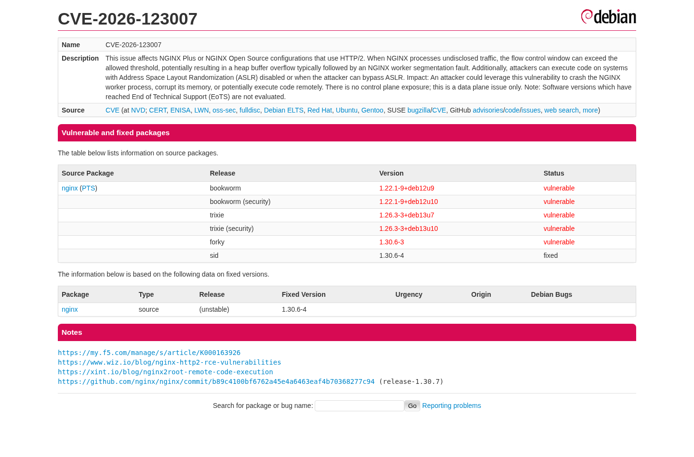

# nginx2root patches for Debian and CentOS NGINX

Backported Debian, CentOS 7 EPEL, and CentOS 8 AppStream packages for the
November 2026 NGINX security fixes, built by
[Hosted Power](https://www.hosted-power.com/). The repository contains the exact
patches, pinned source inputs, reproducible build scripts, and package-upgrade
tests.

These packages contain the complete fixes for every nginx2root vulnerability that
applies to each release. They are not a mitigation and need no follow-up.

The packages preserve the distribution build configuration and package layout.
Their versions are deliberately ordered below the next distribution update, so if
your distribution ships its own update later, it takes over automatically through
normal package upgrades.

## Keep HTTP/2 on

**Disabling HTTP/2 does not fix nginx2root.** It only blocks CVE-2026-123007 and
CVE-2026-123633. The other three stay open: the resolver (CVE-2026-123634), the
mail proxy (CVE-2026-113425) and HTTP/3 (CVE-2026-121810). It also costs
performance for every client. These packages fix all applicable issues, so
HTTP/2 can stay enabled.

If you disabled HTTP/2 as a stopgap: install the packages (the upgrade restarts
NGINX), re-enable HTTP/2 (`listen 443 ssl http2;` on Debian 9–12 and CentOS 7/8,
`http2 on;` on Debian 13), then run `nginx -t` and reload.

[](https://security-tracker.debian.org/tracker/CVE-2026-123007)

*Debian Security Tracker on 19 November 2026. Click the screenshot for the live status.*

## Packages: Debian 8 through 13 and CentOS 7 through 8

The `v1.3.0` release contains complete x86-64 package sets:

| Debian | Base package | Hotfix package | Included fixes |
|---|---|---|---|
| 8 Jessie | `1.6.2-5+deb8u10` | `1.6.2-5+deb8u10.1~hp1` | CVE-2026-123634, CVE-2026-113425 |
| 9 Stretch | `1.10.3-1+deb9u10` | `1.10.3-1+deb9u10.1~hp1` | CVE-2026-123007, CVE-2026-123633, CVE-2026-123634, CVE-2026-113425 |
| 10 Buster | `1.14.2-2+deb10u9` | `1.14.2-2+deb10u9.1~hp1` | the same four |
| 11 Bullseye | `1.18.0-6.1+deb11u9` | `1.18.0-6.1+deb11u9.1~hp1` | the same four |
| 12 Bookworm | `1.22.1-9+deb12u10` | `1.22.1-9+deb12u10.1~hp1` | CVE-2026-123007, CVE-2026-123633, CVE-2026-123634, CVE-2026-113425 |
| 13 Trixie | `1.26.3-3+deb13u10` | `1.26.3-3+deb13u10.1~hp1` | the same four, plus CVE-2026-121810 (HTTP/3) |

Debian 8 NGINX predates HTTP/2, so CVE-2026-123007 and CVE-2026-123633 do not
apply. Its package contains the resolver and mail proxy fixes. Debian 8 through
11 use source packages from Freexian Extended LTS.
Their older NGINX trees require small context adaptations and, for Debian 9 and
10, the upstream SMTP duplicate-resolution prerequisite from 2019. Every adapted
source tree is checked for the security-sensitive conditions before it is built.

| Distribution | Base package | Hotfix package | Included fixes |
|---|---|---|---|
| CentOS 7 archived EPEL | `1:1.20.1-10.el7` | `1:1.20.1-10.el7.0.1.hp1` | CVE-2026-123007, CVE-2026-123633, CVE-2026-123634, CVE-2026-113425 |
| CentOS 8 AppStream 1.14 (original/default) | `1:1.14.1-9.module_el8.0.0+184+e34fea82` | `1:1.14.1-9.module_el8.0.0+184+e34fea82.0.1.hp1` | CVE-2026-123007, CVE-2026-123634, CVE-2026-113425 |
| CentOS 8 AppStream 1.16 | `1:1.16.1-2.module_el8.4.0+820+127618ce.1` | `1:1.16.1-2.module_el8.4.0+820+127618ce.1.0.1.hp1` | the same three |
| CentOS 8 AppStream 1.18 | `1:1.18.0-3.module_el8.4.0+818+5ada96a6.1` | `1:1.18.0-3.module_el8.4.0+818+5ada96a6.1.0.1.hp1` | the same three |
| CentOS 8 AppStream 1.20 | `1:1.20.0-2.module_el8.5.0+899+43b718f6` | `1:1.20.0-2.module_el8.5.0+899+43b718f6.0.1.hp1` | the same three, plus CVE-2026-123633 |

The CentOS 7 package set targets only NGINX installed from the archived EPEL 7
package family. The installer rejects nginx.org, control-panel, and other package
families rather than attempting an unsafe cross-vendor replacement.

CentOS Linux 8 shipped NGINX through AppStream from its first 1.14 default
stream onward. Separate bundles preserve the exact package version, module
stream identity, modularity label, package layout, and ABI for each of the four
final official CentOS Linux 8 streams. The installer upgrades only an exact
matching package family and rejects cross-stream or cross-vendor replacement.

## AlmaLinux 8 through 10

AlmaLinux released official fixed NGINX packages on 18 November 2026 for every
stream still in its RHEL lifecycle. AlmaLinux 8 users should select the supported
`nginx:1.24` stream; AlmaLinux 9 has fixed default 1.20 and supported 1.24/1.26
streams; AlmaLinux 10 has fixed default 1.26 packages. Update these systems from
the normal AlmaLinux repositories:

```bash
sudo dnf update nginx 'nginx-*'
sudo nginx -t
```

The CentOS Linux 8 bundles must not be installed on AlmaLinux. Retired
AlmaLinux 8 streams 1.14, 1.16, 1.18, 1.20, and 1.22 should be migrated to the
supported 1.24 stream.

## Download and install

Download the bundle for the matching Debian or CentOS package family from
[Releases](https://github.com/HOSTED-POWER/nginx2root-patches/releases), then:

```bash
sha256sum --ignore-missing -c SHA256SUMS
tar -xJf nginx2root-patches-v1.3.0-debian12-amd64.tar.xz
cd nginx2root-patches-v1.3.0-debian12-amd64
sha256sum -c SHA256SUMS
sudo ./install.sh
```

Choose the bundle matching the host's exact Debian major release. The installer
checks the Debian release and architecture, validates the existing NGINX
configuration, and upgrades exactly the matching packages already installed on
the host. It does not add unused modules or metapackages. It validates NGINX
again afterward and, if the service was active before the upgrade, confirms that
it remains active.

The bundle contains matching packages for every module and metapackage built from
Debian's NGINX source package. This matters for `libnginx-mod-mail`, which carries
the CVE-2026-113425 fix, and for version-locked Debian metapackages.

Verify immediately after installation:

```bash
sudo nginx -t
systemctl is-active nginx
nginx -v
```

The packages are also published in Hosted Power's existing Debian repository for
managed systems. The GitHub release is provided so the build and binaries are
publicly auditable and independently usable.

For CentOS 7 with the archived EPEL package family:

```bash
sha256sum --ignore-missing -c SHA256SUMS
tar -xJf nginx2root-patches-v1.3.0-centos7-epel-x86_64.tar.xz
cd nginx2root-patches-v1.3.0-centos7-epel-x86_64
sha256sum -c SHA256SUMS
sudo ./install-rpm.sh
```

The RPM installer upgrades only already-installed NGINX packages from the bundle,
checks configuration before and after, and verifies that an active service stays
active.

For CentOS Linux 8, first identify the installed AppStream family:

```bash
rpm -q nginx
```

Download the matching `centos8-appstream-1.14`, `1.16`, `1.18`, or `1.20`
bundle. For example, for the original/default 1.14 line:

```bash
sha256sum --ignore-missing -c SHA256SUMS
tar -xJf nginx2root-patches-v1.3.0-centos8-appstream-1.14-x86_64.tar.xz
cd nginx2root-patches-v1.3.0-centos8-appstream-1.14-x86_64
sha256sum -c SHA256SUMS
sudo ./install-centos8-rpm.sh
```

The CentOS 8 installer has the same pre/post configuration and service checks,
and additionally verifies the exact AppStream package release before upgrading.

## Safe upgrade path

The version ordering is intentional:

```text
distribution base < Hosted Power hotfix < distribution point update
```

For example:

```text
1.22.1-9+deb12u10 < 1.22.1-9+deb12u10.1~hp1 < 1.22.1-9+deb12u10.1
```

No pin, hold, new epoch, diversion, or package-name change is used. A higher
distribution package replaces the matching hotfix through normal package updates.

## Build and test

On a host with Docker:

```bash
./build.sh
./release.sh
```

The build:

1. downloads exact Debian, archived EPEL, and CentOS AppStream source packages
   and verifies pinned SHA-256 hashes;
2. applies the vendor source package changes, then the applicable reviewed security patches;
3. checks the security-sensitive source conditions after patching;
4. builds unprivileged inside clean matching `debian:8` through `debian:13`,
   `centos:7`, and `centos:8` containers;
5. upgrades a stock container, preserves the NGINX module ABI, runs `nginx -t`,
   and serves an HTTP/2 smoke request;
6. confirms each hotfix sorts above the vulnerable package and below a future vendor update.

The committed security patches are copied from Debian's fixed `nginx 1.30.6-4`
source package and retain their upstream commit links and authorship. Older
releases need narrowly scoped context adaptations in `scripts/build-deb.sh` and
`scripts/build-centos8-rpm.sh`; the resulting source semantics are checked by
`scripts/test-patches.sh`.

## Scope

- Architectures in `v1.3.0`: Debian amd64 and CentOS x86-64 only.
- Debian 8, 9, 10, and 11 and CentOS 7 and 8 are EOL releases. Their NGINX
  hotfixes do not provide security support for the rest of the operating system.
- Debian 8 through 11 source provenance is
  Freexian Extended LTS, and users must separately ensure their full operating
  system remains supported and patched.
- These packages preserve the distribution's configuration paths, maintainer scripts,
  compile options, and dynamic-module ABI.
- They do not make an exposed NGINX configuration safe by themselves unless the
  matching `nginx` binary and any installed affected module are upgraded.
- No warranty is provided. Review the patches and checksums before deployment.

## Sources

- [Debian tracker: CVE-2026-123007](https://security-tracker.debian.org/tracker/CVE-2026-123007)
- [Debian tracker: CVE-2026-123633](https://security-tracker.debian.org/tracker/CVE-2026-123633)
- [Debian tracker: CVE-2026-123634](https://security-tracker.debian.org/tracker/CVE-2026-123634)
- [Debian tracker: CVE-2026-113425](https://security-tracker.debian.org/tracker/CVE-2026-113425)
- [Debian tracker: CVE-2026-121810](https://security-tracker.debian.org/tracker/CVE-2026-121810)
- [Debian fixed source package](https://tracker.debian.org/pkg/nginx)
- [Freexian Extended LTS repository](https://deb.freexian.com/extended-lts/)
- [Archived EPEL 7 packages](https://archives.fedoraproject.org/pub/archive/epel/7/)
- [Archived CentOS Linux 8 AppStream packages](https://vault.centos.org/8.5.2111/AppStream/)
- [AlmaLinux NGINX security update guidance](https://almalinux.org/blog/2026-11-18-nginx2root/)
- [AlmaLinux 9 erratum ALSA-2026-A025](https://errata.almalinux.org/9/ALSA-2026-A025.html)
- [AlmaLinux 10 erratum ALSA-2026-A024](https://errata.almalinux.org/10/ALSA-2026-A024.html)
